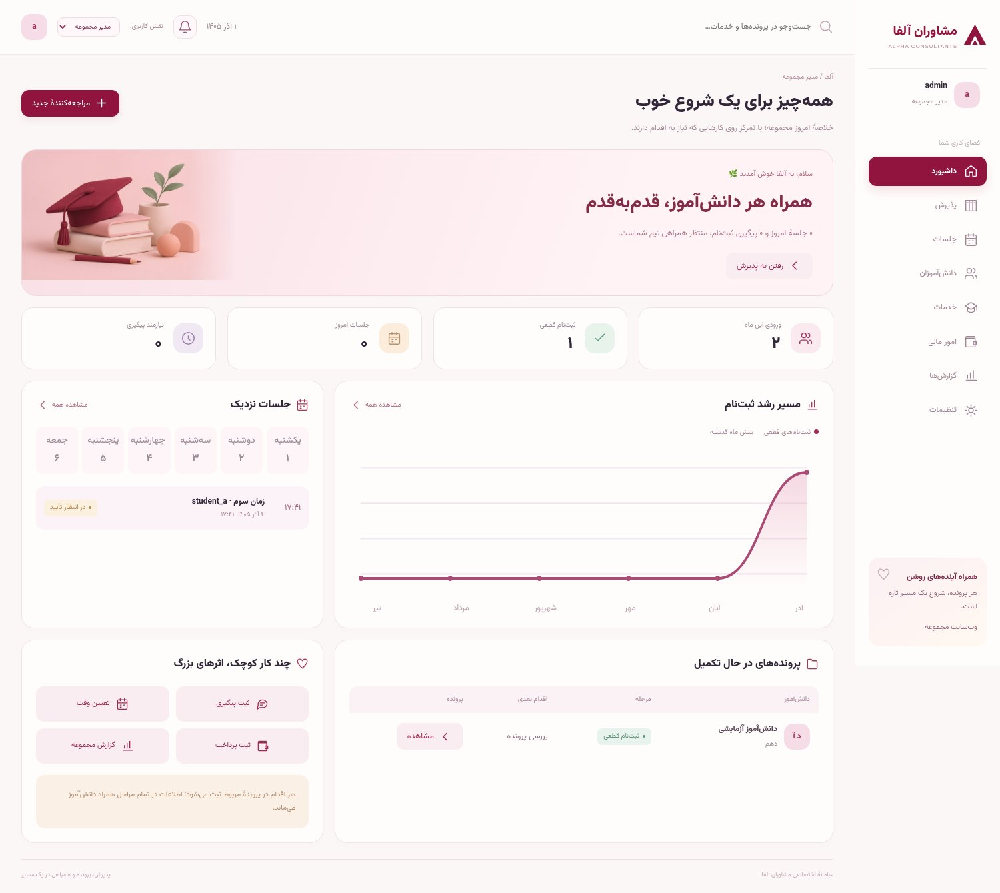
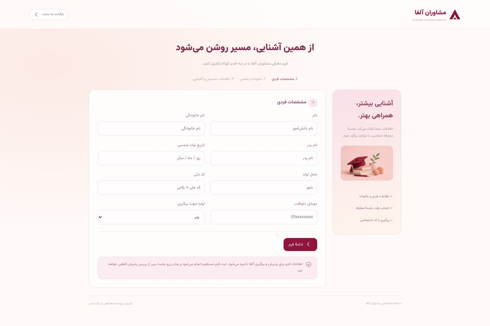

# آلفا — نسخهٔ بازطراحی‌شده ۰.۲.۰

[دانلود بستهٔ کامل](https://github.com/ehs4niw/openai-chat/raw/refs/heads/alpha-platform-v0.2.0/Alpha-Platform-0.2.0-Design.zip)

ظاهر پنل با استایل و چیدمان مرجع `Alpha-design.zip` بازسازی شده است: سایدبار، سربرگ، تصویر خوش‌آمدگویی، کارت‌ها، نمودارها، تقویم، پروندهٔ چهار‌تبی، فرم سه‌مرحله‌ای و دیالوگ‌های پرداخت، پیگیری و تعیین وقت. اعداد، نام‌ها و نمودارها از داده‌های واقعی وردپرس می‌آیند؛ تصاویر زیر با دادهٔ آزمایشی محلی گرفته شده‌اند.

ثبت فرم مستقیم وارد پذیرش می‌شود و تأیید جداگانه نمی‌خواهد. **فقط زمان رزرو جلسه** پس از تأیید پذیرش قطعی می‌شود. تغییر وقت نیز ظرفیت را جابه‌جا و زمان جدید را در انتظار تأیید قرار می‌دهد.

۲۶ بررسی فرآیندی در وردپرس محلی و تست مرورگر پنج نقش، دیالوگ‌ها، ثبت/بررسی رسید و موبایل پاس شده‌اند. تست هم‌زمانی MySQL و ورود پیامکی آموزشیار روی کپی سایت همچنان لازم است؛ این نسخه تحویل نهایی تمام امکانات قرارداد نیست.

ZIP اصلی افزونه نیست: آن را استخراج کنید. از `installers` ابتدا هسته و سپس شش افزونهٔ دیگر را نصب یا با نسخهٔ قبلی همان افزونه جایگزین کنید. راهنمای فارسی، سورس محصول، فایل‌های ساخت و ۲۴ پیش‌نمایش داخل بسته‌اند. نخست روی کپی آزمایشی سایت نصب شود.

## داشبورد

## فرم معرفی

